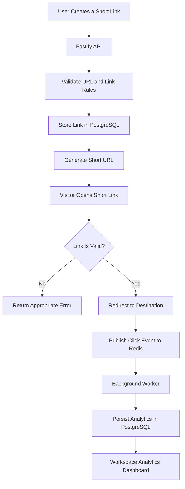

# 🔗 LinkPulse API

### Smart URL Shortening & Click Analytics Platform

[](https://nodejs.org/)
[](https://www.typescriptlang.org/)
[](https://fastify.dev/)
[](https://www.postgresql.org/)
[](https://redis.io/)

**LinkPulse** is a backend-first URL management and analytics platform that transforms long URLs into short, shareable links while providing secure redirects, link controls, and asynchronous click analytics.

> 🚀 Create shorter links. Manage campaigns. Understand engagement.

**🌐 Live Demo:** [Open LinkPulse](https://YOUR-LIVE-URL.com)  
**💻 GitHub Repository:** [View Source Code](https://github.com/YOUR-USERNAME/YOUR-REPOSITORY)

---

## 📌 Table of Contents

- [Problem Statement](#-problem-statement)
- [Our Solution](#-our-solution)
- [Key Features](#-key-features)
- [Screenshots](#-screenshots)
- [Tech Stack](#-tech-stack)
- [How It Works](#-how-it-works)
- [Getting Started](#-getting-started)
- [Environment Variables](#-environment-variables)
- [API Reference](#-api-reference)
- [Security & Reliability](#-security--reliability)
- [Testing](#-testing)
- [Deployment](#-deployment)
- [Project Structure](#-project-structure)
- [Contributing](#-contributing)
- [License](#-license)

---

## 🎯 Problem Statement

Long URLs are difficult to share, manage, and track. Teams and individuals often lack a centralized solution for controlling link access, setting expiration rules, managing campaigns, and understanding user engagement.

Traditional URL shorteners may also provide limited control over protected links and the reliability of analytics processing.

## 💡 Our Solution

LinkPulse provides a centralized platform for creating and managing short URLs with configurable access rules and analytics.

It combines a high-performance API with PostgreSQL persistence and Redis-powered event processing to keep redirects responsive while click analytics are processed asynchronously.

## ✨ Key Features

| Feature | Description |
|---|---|
| 🔗 URL Shortening | Convert long URLs into compact, shareable links. |
| 🔐 Authentication | Register, log in, and manage workspace access. |
| 🏢 Workspaces | Organize and manage links within workspaces. |
| ⏳ Expiration Rules | Set expiration dates and maximum click limits. |
| 🔒 Password Protection | Restrict access to protected links. |
| ⚡ Fast Redirects | Validate link status before redirecting visitors. |
| 📊 Click Analytics | View engagement metrics and link performance. |
| 🔄 Async Event Processing | Process click events through Redis Streams and a worker. |
| 🛡️ Input Validation | Validate URLs and reject unsafe destinations. |
| ♻️ Link Management | Inspect, update, and disable existing links. |

## 🖼️ Screenshots

### LinkPulse Dashboard


### Link Management & Analytics


---

## 🧰 Tech Stack

| Technology | Purpose |
|---|---|
| **Node.js 22+** | JavaScript runtime |
| **TypeScript** | Type-safe application development |
| **Fastify** | High-performance API framework |
| **PostgreSQL** | Persistent relational data storage |
| **Prisma ORM** | Database access and schema management |
| **Redis Streams** | Asynchronous click-event processing |
| **Docker Compose** | Local development infrastructure |
| **npm** | Package management and scripts |

---

## ⚙️ How It Works



**Architecture highlights:**
- Redirect handling and click-event processing are separated.
- Redis Streams decouple analytics ingestion from redirect requests.
- PostgreSQL stores links, workspaces, and persisted analytics.
- The worker supports retries and dead-letter handling for failed events.

---

## 🚀 Getting Started

### Prerequisites

Make sure you have the following installed:

- [Node.js 22 or later](https://nodejs.org/)
- npm
- [Docker Desktop](https://www.docker.com/products/docker-desktop/) for persistent local development

### 1. Clone the Repository

```bash
git clone https://github.com/YOUR-USERNAME/YOUR-REPOSITORY.git
cd YOUR-REPOSITORY
```

### 2. Install Dependencies

```bash
npm install
```

### 3. Configure Environment Variables

Create a local `.env` file using the variables required by the project.

```bash
cp .env.example .env
```

If `.env.example` is not present, create `.env` manually using the environment-variable documentation below and the project's configuration.

**Never commit your actual `.env` file or secrets to GitHub.**

### 4. Start PostgreSQL and Redis

For persistent local development, start the services using the repository's Docker Compose configuration:

```bash
docker compose up -d
```

Ensure the database and Redis URLs in `.env` match your local configuration.

### 5. Generate the Prisma Client

```bash
npm run db:generate
```

### 6. Apply Database Migrations

```bash
npm run db:deploy
```

### 7. Start the API Server

```bash
npm run dev
```

The API and web application are served at:

**http://localhost:3000**

### 8. Start the Analytics Worker

In a separate terminal:

```bash
npm run dev:worker
```

The worker processes queued click events and persists analytics.

> **Quick demo:** If supported by your configuration, set `DEMO_MODE=true` to use in-memory demo mode. This mode is intended for demonstration, not production. Persistent storage is required for durable data.

---

## 🔑 Environment Variables

Configure the variables required by your deployment. Exact names and defaults should match the project's environment configuration.

| Variable | Purpose |
|---|---|
| `DATABASE_URL` | PostgreSQL connection string |
| `REDIS_URL` | Redis connection string |
| `DEMO_MODE` | Enables the in-memory demo mode when supported |
| SMTP configuration | Email delivery for password-reset requests |

Keep all credentials and secrets private. Set production values through your hosting provider's environment-variable settings.

---

## 📡 API Reference

All endpoints should be called using the deployed API base URL or your local development URL.

### Authentication

| Method | Endpoint | Description |
|---|---|---|
| `POST` | `/auth/guest` | Create a guest session |
| `POST` | `/auth/register` | Register an account |
| `POST` | `/auth/login` | Authenticate a user |
| `GET` | `/auth/me` | Get the current user |
| `POST` | `/auth/password-reset/request` | Request a password reset |
| `POST` | `/auth/password-reset/confirm` | Confirm a password reset |

### Workspaces

| Method | Endpoint | Description |
|---|---|---|
| `GET` | `/workspaces` | List accessible workspaces |
| `POST` | `/workspaces` | Create a workspace |

### Link Management

| Method | Endpoint | Description |
|---|---|---|
| `POST` | `/workspaces/:workspaceId/links` | Create a short link |
| `GET` | `/workspaces/:workspaceId/links` | List workspace links |
| `GET` | `/workspaces/:workspaceId/links/:linkId` | Get link details |
| `PATCH` | `/workspaces/:workspaceId/links/:linkId` | Update a link |
| `POST` | `/workspaces/:workspaceId/links/:linkId/disable` | Disable a link |
| `GET` | `/:alias` | Redirect through a short link |

Protected links use the `x-link-password` header to provide the link password.

### Analytics

| Method | Endpoint | Description |
|---|---|---|
| `GET` | `/workspaces/:workspaceId/analytics/overview` | Retrieve workspace analytics |
| `GET` | `/workspaces/:workspaceId/analytics/links` | Retrieve per-link analytics |

Analytics endpoints support date-range filters. Refer to the project's API implementation for accepted parameters and response schemas.

### Health Checks

| Method | Endpoint | Description |
|---|---|---|
| `GET` | `/health/live` | Check whether the API process is alive |
| `GET` | `/health/ready` | Check service readiness |

---

## 🛡️ Security & Reliability

- Validates destination URLs and rejects unsafe destinations.
- Enforces authentication and workspace access controls.
- Supports expiring links, click limits, and password-protected redirects.
- Hashes stored link passwords and password-reset tokens.
- Applies rate limits to sensitive endpoints.
- Redacts sensitive password data from logs.
- Avoids storing raw visitor IP addresses in click analytics.
- Uses asynchronous event processing with retries and dead-letter handling.

**Operational note:** If Redis is unavailable, a redirect may still succeed while its analytics event is lost. Configure and monitor infrastructure according to your reliability requirements.

---

## 🧪 Testing & Validation

Run the following commands as applicable to the repository:

```bash
npm test
npm run build
npm run db:generate
npx prisma validate
npm audit
git diff --check
```

Resolve failing tests, build errors, dependency vulnerabilities, and formatting issues before submitting.

---

## ☁️ Deployment

Deploy the application using a supported hosting provider.

Typical deployment components include:

- **API:** Render or another Node.js-compatible hosting provider
- **Database:** A managed PostgreSQL instance
- **Redis:** A compatible managed Redis service
- **Worker:** A separate background worker process
- **Frontend:** Vercel, if deployed separately

For deployment details, see:

- [`docs/architecture.md`](docs/architecture.md)
- [`docs/deployment.md`](docs/deployment.md)


---

## 📁 Project Structure

```text
.
├── docs/
│   ├── architecture.md
│   └── deployment.md
├── prisma/
├── src/
├── .env.example
├── .gitignore
├── docker-compose.yml
├── package.json
├── package-lock.json
└── README.md
```

*The structure above is illustrative. Adjust it to match the actual repository.*

---

## 🤝 Contributing

Contributions are welcome!

1. Fork the repository.
2. Create a feature branch.
3. Make your changes and run the relevant tests.
4. Commit with a descriptive message.
5. Open a pull request.

Examples of meaningful commit messages:

```text
feat: add link expiration
fix: validate redirect destinations
docs: improve deployment instructions
test: cover password-protected links
```

For team submissions, each member should commit using their own GitHub account to make contributions transparent.

## 📄 License

Add your project's actual license here. If the repository includes a `LICENSE` file, link to it rather than claiming a license that has not been selected.

---

<p align="center">
  <strong>Built with ❤️ @Pantkarik,@nowordsyours,@karanjeet,@Lordparam</strong>
  <br />
  <sub>LinkPulse — Short links. Smarter analytics.</sub>
</p>
